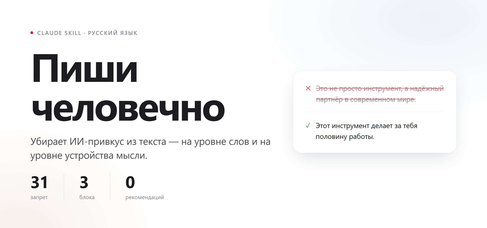
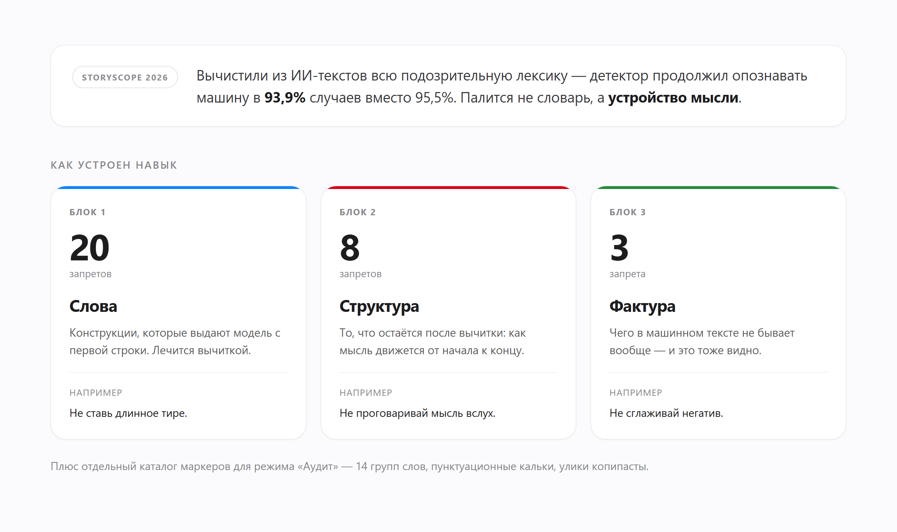
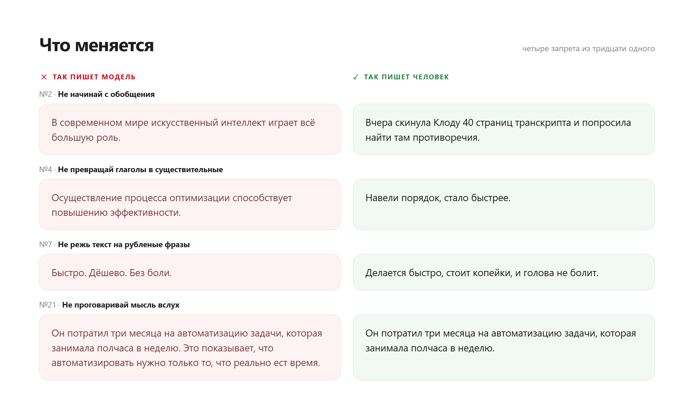

<div align="center">



<br><br>

**Навык для Claude, который убирает ИИ-привкус из русского текста.**
Не советами, а запретами: 31 штука, три уровня.

<br>

</div>

---

## Зачем

«Пиши живо» модель понимает как «добавь эмодзи». «Не начинай с обобщения» она понимает буквально.

Поэтому навык устроен как список запретов. У каждого есть формулировка, короткое объяснение и пара примеров: как пишет модель и как пишет человек.

Главное здесь — второй блок. Исследование StoryScope (Университет Мэриленда и Google DeepMind, 2026; 61 608 текстов из шести источников) проверило, что будет, если вычистить из ИИ-текста всю подозрительную лексику. Детектор продолжил опознавать машину в 93,9% случаев вместо 95,5%. Полтора пункта. Значит, дело не в словаре, а в том, как движется мысль.

<br>



<br>

## Что меняется в тексте



<br>

## Установка

### Claude Code

Положи папку навыка туда, где Claude Code ищет скиллы:

```bash
git clone https://github.com/gc-tilda/pishi-chelovechno.git ~/.claude/skills/pishi-chelovechno
```

Для одного проекта — в `.claude/skills/` внутри репозитория проекта.

### claude.ai и Claude Desktop

Нужен файл `.skill` — это обычный zip с папкой навыка внутри.

```bash
zip -r pishi-chelovechno.skill pishi-chelovechno/
```

Дальше: **Settings → Capabilities → Skills → Upload skill**.

<br>

## Как вызвать

Навык молчит, пока его не позовут. Ни при написании постов, ни при редактуре он сам не включается.

Работают фразы:

- «пиши человечно»
- «убери иишность» / «убери AI-привкус»
- «не пиши как нейросеть»
- «сделай живее»
- «очеловечь текст»
- «пиши как я»

И прямой вызов: `/pishi-chelovechno`

<br>

## Три режима

| Режим | Что делает |
|---|---|
| **Написать с нуля** | Держит запреты по ходу письма, в конце прогоняет самопроверку |
| **Переписать готовое** | Сначала диагноз с цитатами, потом правка. Факты, цифры и имена не трогает |
| **Аудит** | Только диагноз: список нарушений и вердикт, текст остаётся как был |

По умолчанию — переписать.

<br>

## Запреты можно нарушать

Но не молча. Нарушение разрешено, если выполняется одно из условий:

- ты прямо разрешил («тут длинное тире нужно»)
- это цитата, чужой текст, термин или юридическая формулировка
- жанр требует: официальное письмо, документация, научный текст, проза, поэзия
- без нарушения текст станет неточным

Тогда в конце ответа появится одна строка: что нарушено и почему. Если один и тот же запрет отменяется трижды, навык предложит выключить его для проекта насовсем.

<br>

## Что внутри

```
pishi-chelovechno/
├── SKILL.md                        31 запрет, режимы, самопроверка
└── references/
    └── полный-каталог.md           маркеры для режима «Аудит»:
                                    14 групп слов, пунктуационные кальки,
                                    улики копипасты, морфологические сбои
```

Каталог подгружается отдельно, когда основных запретов не хватило.

<br>

## Источники

- StoryScope: Investigating idiosyncrasies in AI fiction. Russell, Rajendhran, Pham, Iyyer, Wieting. University of Maryland + Google DeepMind, 2026. [github.com/jenna-russell/storyscope](https://github.com/jenna-russell/storyscope)
- [ilyautov/humanizer-ru](https://github.com/ilyautov/humanizer-ru) — каталог 54 паттернов
- [Vladimir-Human/humanizer-ru](https://github.com/Vladimir-Human/humanizer-ru) — реестр языковых паттернов и артефактов
- [Почему тексты нейросетей раздражают читателя](https://habr.com/ru/articles/1022426)

<br>

## Лицензия

MIT. Забирай, правь под себя, выкладывай.
